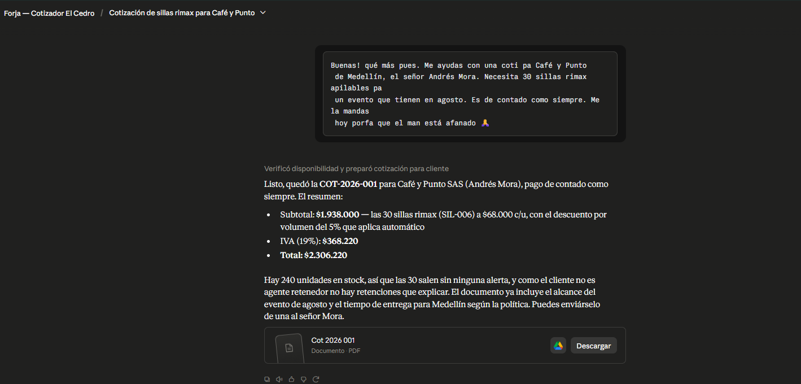
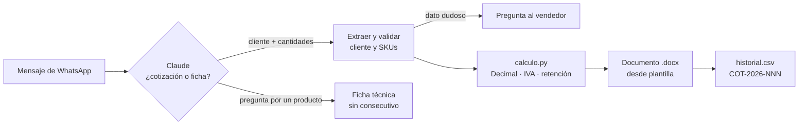
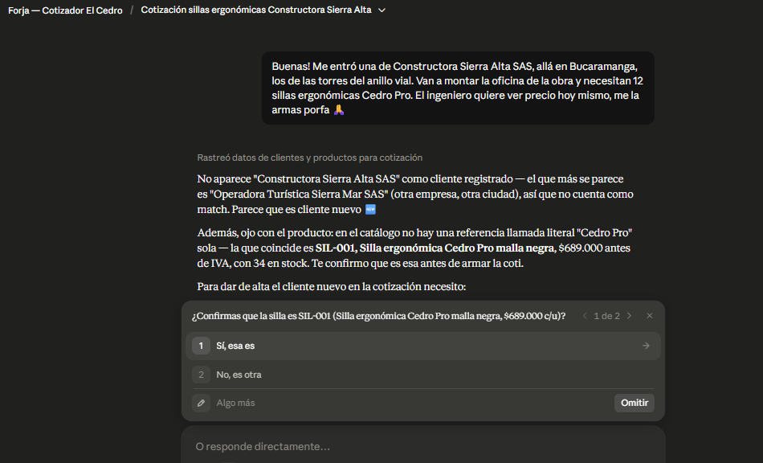
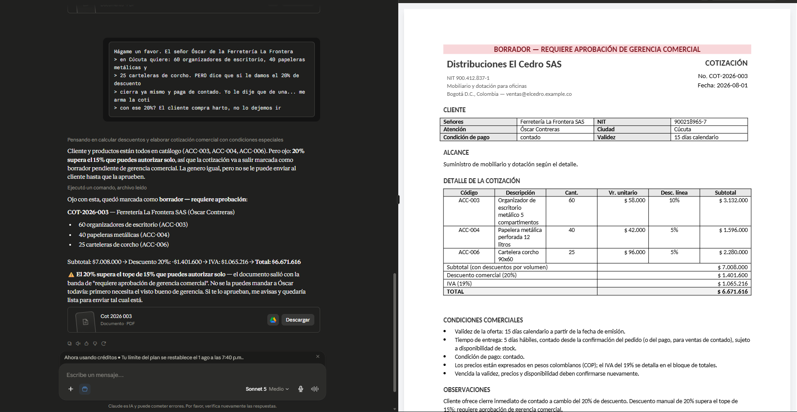
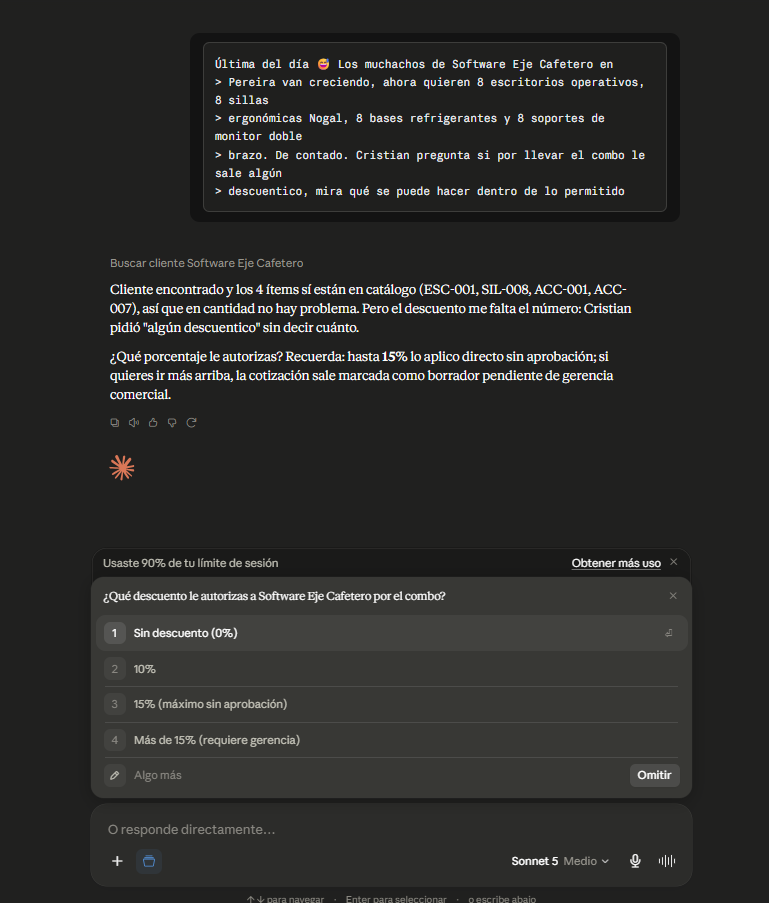
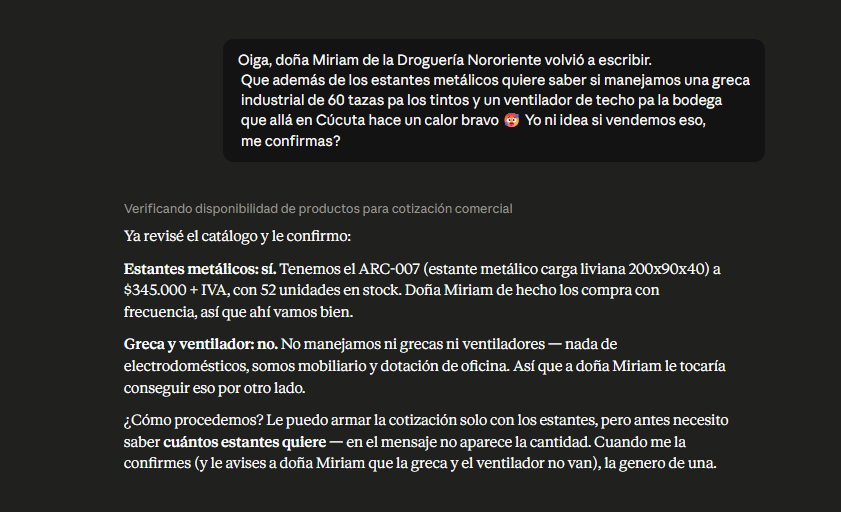

# Forja — un agente que convierte un WhatsApp en una cotización formal

> *"Me ayudas con una coti pa Café y Punto… 30 sillas rimax… me la mandas hoy
> porfa que el man está afanado 🙏"*
>
> → **COT-2026-001**, con descuento por volumen, IVA, consecutivo y documento
> Word listo para enviar.

Forja es una **skill de Claude** que diseñé y construí para el reto R3 de la
Maratón de IA (Smart4AI + Ruta N): automatizar las cotizaciones de una pyme
colombiana de mobiliario de oficina. El vendedor pega el mensaje tal como le
llega y el agente decide qué documento corresponde, valida cliente y productos,
calcula con código y entrega el documento.



| 16 | 86 | 0 | 2 |
| :-: | :-: | :-: | :-: |
| solicitudes estilo WhatsApp resueltas de punta a punta | tests automatizados | cifras calculadas por el modelo | tipos de documento: cotización y ficha técnica |

## El reto

En una pyme comercial, armar cada cotización a mano (buscar precios, aplicar
descuentos, liquidar IVA y retenciones, maquetar el documento, llevar el
consecutivo) consume horas y se presta a errores. Mientras tanto, el cliente
que "está afanado" se enfría. Y no todo lo que llega por WhatsApp pide precio:
buena parte de la jornada se va en "¿qué medidas tiene?" o en armar la ficha de
un producto para un proceso de compra.

## La idea central: el modelo entiende, el código calcula

Un LLM haciendo cálculos de IVA y retención falla en silencio, y justo cuando
hay un cliente esperando. Por eso Forja separa responsabilidades:



- **Claude** interpreta el mensaje informal, elige la ruta, redacta y conversa
  con el vendedor.
- **Python** hace toda la aritmética. `calculo.py` es un núcleo puro, sin I/O,
  especificado en `skill/references/reglas_tributarias.md`, con `Decimal` y
  redondeo a pesos. Sus tests (`tests/test_calculo.py`) traen los valores
  esperados calculados a mano en comentarios, así que se pueden auditar sin
  ejecutar nada.
- **El `SKILL.md`** es el contrato del agente: un workflow obligatorio de siete
  pasos y las reglas que no puede romper.

## Guardrails: lo que el agente se niega a inventar

La regla de diseño es una sola: **ante la duda, pregunta; no inventa.** Cada
caso del set de prueba la pone a prueba.

**Un cliente parecido no es el mismo cliente.** Las razones sociales
colombianas se parecen mucho. Si la coincidencia es moderada, el agente muestra
los candidatos con su puntaje y pregunta. Cotizar a nombre de la empresa
equivocada le pone al documento un NIT y un régimen tributario ajenos.



**Un descuento por encima del tope no se rechaza: se escala.** El vendedor ya
le prometió el 20 % al cliente, pero el tope autónomo es 15 %. Forja calcula
igual y emite el documento con banda de borrador que exige aprobación de
gerencia.



**"Algún descuentico" no es una cifra.** El porcentaje es una decisión
comercial, así que el agente pregunta y recuerda dónde está el tope.



**Un producto que no está en el catálogo no se estima.** El motor lanza
`SkuNoEncontrado` y la skill tiene prohibido asumir equivalencias: pregunta si
se reemplaza o se excluye.



Además: el stock agotado se cotiza a precio pleno con alerta y nota de
reposición; la retención en la fuente se muestra como informativa sin restarla
del total; y un cliente nuevo se cotiza de contado, sin darlo de alta, porque
el registro es trabajo de cartera y un sistema que edita su propia fuente de
datos deja de ser auditable.

## Ficha técnica: tampoco inventa especificaciones

Una pregunta como "¿qué medidas tiene el ARC-007?" no es una cotización de una
unidad. Forja la responde con una ficha que **no consume consecutivo**, y
extrae las especificaciones del catálogo de forma literal:

|                 | **ARC-007** · Estante metálico carga liviana 200x90x40 | **SIL-008** · Silla ergonómica Nogal con soporte lumbar |
| --------------- | ------------------------------------------------------ | ------------------------------------------------------- |
| Dimensiones     | 200 × 90 × 40 cm                                       | *No registradas en catálogo*                            |
| Materiales      | Metal                                                  | *No registrados en catálogo*                            |
| Características | *No registradas en catálogo*                           | Soporte lumbar                                          |
| Precio de lista | $345.000                                               | $915.000                                                |

"Nogal" es el nombre de una línea comercial, no un material. Un modelo que
dedujera "madera de nogal" habría inventado una especificación que termina
anexada a un pliego de compra. Forja imprime "No registrados en catálogo" y
devuelve una alerta.

## Pruébalo

Requiere Python 3.10+. Los comandos son para bash (en Windows, Git Bash).

```bash
pip install python-docx pytest
python -m pytest -q        # 86 passed
```

**Cotización** (solicitud 1, solo cálculo, sin consumir consecutivo):

```bash
echo '{"cliente": "Cafe y Punto", "items": [{"sku": "SIL-006", "cantidad": 30}]}' \
  | python skill/scripts/cotizar.py --solo-calculo --salidas pruebas
```

Devuelve subtotal $1.938.000, IVA $368.220 y **total $2.306.220**. Sin
`--solo-calculo` genera además el `.docx` y lo asienta en el historial de la
carpeta de salidas (usa una carpeta propia como `pruebas/`: `salidas/` guarda
el historial de la demo).

**Cliente nuevo** (el cliente va como objeto y sale con la alerta de cartera):

```bash
echo '{"cliente": {"nit": "901999888-1", "razon_social": "Inversiones La Floresta SAS",
       "contacto": "Ana Ruiz", "ciudad": "Bogota", "agente_retenedor": false},
       "items": [{"sku": "SIL-006", "cantidad": 30}]}' \
  | python skill/scripts/cotizar.py --solo-calculo --salidas pruebas
```

**Ficha técnica** (dos SKUs; nunca consume consecutivo):

```bash
python skill/scripts/cotizar.py --modo ficha --entrada demo/peticion_ficha_ejemplo.json --salidas pruebas
```

Si LibreOffice está instalado, los documentos también salen en PDF.

## Instalarlo como skill en claude.ai

Comprimir la carpeta `skill/` renombrada a `forja` (la carpeta como raíz del
ZIP, no los archivos sueltos) y subir el ZIP en Customize → Skills → + →
Create skill. Requiere "Code execution and file creation" activo en Settings →
Capabilities. Después basta con pegar el mensaje de WhatsApp en el chat.

**Desarrollo en Windows.** Para que Claude Code descubra la skill sin duplicar
la carpeta, crear un junction desde **cmd** (`mklink` no existe en PowerShell;
no requiere permisos de administrador):

```bat
mkdir .claude\skills
mklink /J .claude\skills\forja skill
```

## Stack

Claude Skills · Python 3.10+ · `decimal` · python-docx · pytest · LibreOffice
(opcional, PDF) · CSV como persistencia.

## Estructura

```
forja/
├── skill/          ← la unidad de despliegue: esto es lo que se sube a claude.ai
│   ├── SKILL.md    ← workflow obligatorio y reglas del agente
│   ├── scripts/    ← calculo.py (núcleo), datos_io, documento, historial, cotizar (CLI)
│   ├── datos/      ← catálogo, clientes y políticas comerciales
│   ├── assets/     ← plantilla.docx (cotización) y plantilla_ficha.docx
│   └── references/ ← reglas_tributarias.md (especificación del motor)
├── tests/          ← 86 tests sobre el núcleo y los bordes; nunca tocan salidas/
├── salidas/        ← historial.csv de la demo
├── demo/           ← 16 solicitudes estilo WhatsApp + petición de ejemplo
└── docs/           ← arquitectura, plan y registro del proceso
```

## Cómo se construyó

Forja se construyó en cinco días, del 30 de julio al 3 de agosto de 2026, con
Claude y Claude Code bajo mi dirección: primero arquitectura y plan, después
siete fases de ejecución, sin cerrar ninguna sin la suite de tests completa
en verde. El proceso está documentado
completo, con los prompts verbatim y las correcciones del camino:

- [`docs/arquitectura.md`](docs/arquitectura.md): decisiones, descartes y
  cuándo esta arquitectura deja de servir.
- [`docs/proceso.md`](docs/proceso.md): metodología, fases y correcciones.
- [`docs/plan-forja.md`](docs/plan-forja.md): el plan por fases.
- [`docs/prompts-sesion.md`](docs/prompts-sesion.md): los prompts de
  construcción, en orden.
- [`docs/guion-demo-forja.md`](docs/guion-demo-forja.md): guion de la demo.
- [`demo/resumen_pruebas.md`](demo/resumen_pruebas.md): resultado de las 16
  solicitudes.

## Alcance

La empresa, el catálogo, los clientes y las solicitudes son el set de
demostración del reto. Las reglas tributarias simplifican el régimen
colombiano de forma declarada (`skill/references/reglas_tributarias.md` §5).
Forja no da de alta clientes y sus fichas se limitan a lo que dice el catálogo.

---

**John Restrepo** · [github.com/johnrpo-dev](https://github.com/johnrpo-dev)
